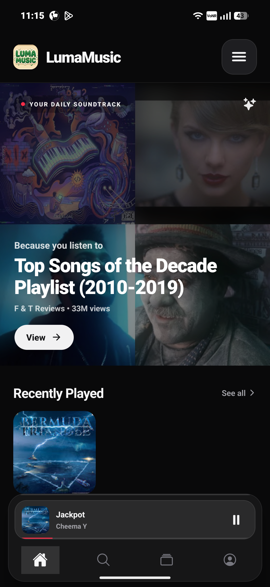
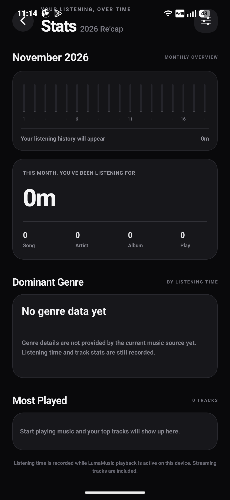
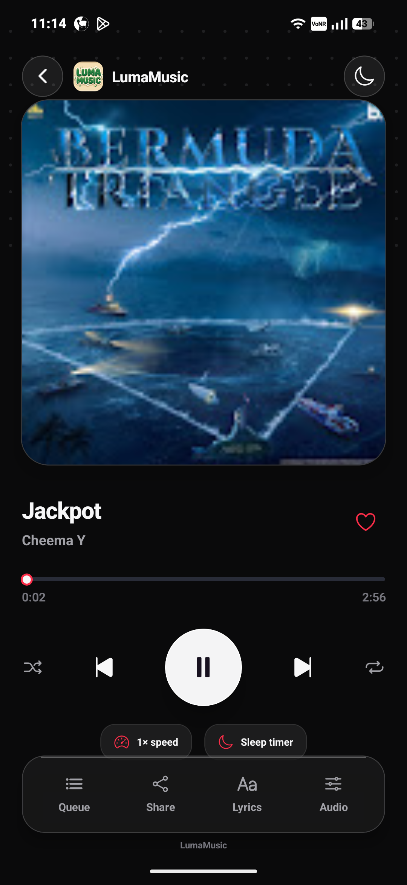

# LumaMusic 🎧

  
  <h3>Your music. Your mood. Your own little corner of sound.</h3>
  
Built with love by <strong>PauzeX Developments</strong> — for the songs you keep coming back to.

  

    <a href="https://lumamusic.devs.surf">🌐 Website</a> ·
    <a href="https://github.com/PauzeDevs/LumaMusic/releases">📲 Get LumaMusic</a> ·
    <a href="https://pauze.is-a.dev/support/">💗 Support the project</a>
  

  
  

---

## Hey guyss! 👋

Welcome to **LumaMusic**!

We're **PauzeX Developments**, and yep — we built this. 🎧 LumaMusic is our own take on a modern music player: a clean, dark interface, a player we actually enjoy using, and a growing set of features to make listening feel a little more personal.

This project is made for **Android and macOS only**. We're focused on making those two experiences better rather than promising support for platforms we don't currently target.

LumaMusic is still a work in progress. We're building, testing, fixing things, and adding improvements update by update. Some features may behave differently depending on your device or music source, so bear with us while we keep polishing things. Thanks for checking it out — seriously, it means a lot. 🫶

## A little peek 👀

  
  
  

Home · Now Playing · Listening Stats

## What can you do with it? 🎶

- **Discover & search** — Find music and explore what's available.
- **Now Playing** — See your track, artwork, progress, and playback controls.
- **Your library** — Keep supported music and playlists organised.
- **Listening stats** — Look back at what you've been listening to.
- **Queue & lyrics** — Keep your next tracks and lyrics close while listening.
- **Audio Lab** — Explore audio controls for supported playback paths and devices.

We're actively working on the experience, so not every feature is guaranteed to work with every music source or device just yet.

## A quick note about music ⚠️

Music availability, playback, artwork, and metadata may depend on third-party services and can change without notice. LumaMusic is an independent project. It is not affiliated with or endorsed by YouTube, YouTube Music, Google, artists, labels, or other music-rights holders.

LumaMusic does not give you ownership or usage rights to third-party music or media. Please respect copyright, the terms of the services you use, and the rights of artists and creators.

## Made by PauzeX Developments 💗

LumaMusic is built and maintained by **[PauzeX Developments](https://pauze.is-a.dev)**.

If you like what we're building and want to support future development, you can visit our [support page](https://pauze.is-a.dev/support/). It's completely optional — even checking out the project and sharing it helps!

## License 📄

LumaMusic is covered by the **PauzeX Proprietary License (PPL) v1.0**.

You're welcome to download, install, and use the unmodified app for your own personal, non-commercial use. Please don't redistribute, share, re-upload, modify, fork, rebrand, or sell it without express written permission from PauzeX Developments.

Read the full terms in the [LICENSE](LICENSE) file. Third-party components and materials remain subject to their own licenses and terms.

---

  Made with 🎧 by <a href="https://pauze.is-a.dev">PauzeX Developments</a>
   
  Thanks for being here. Keep the music going. ✨

