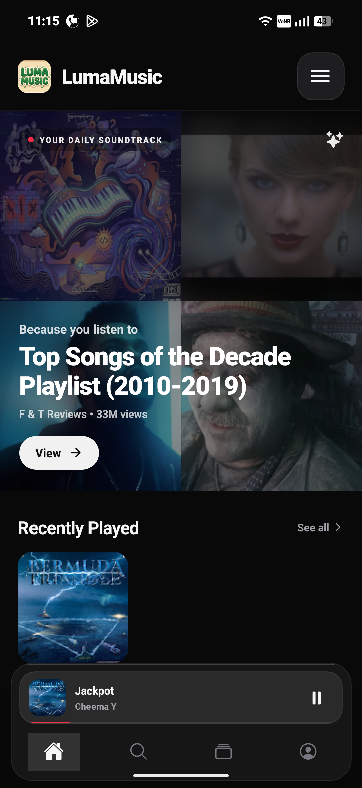
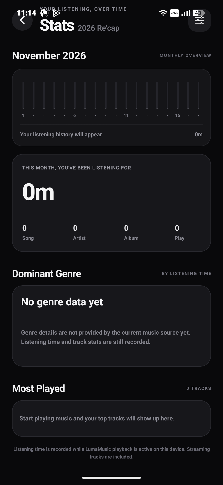
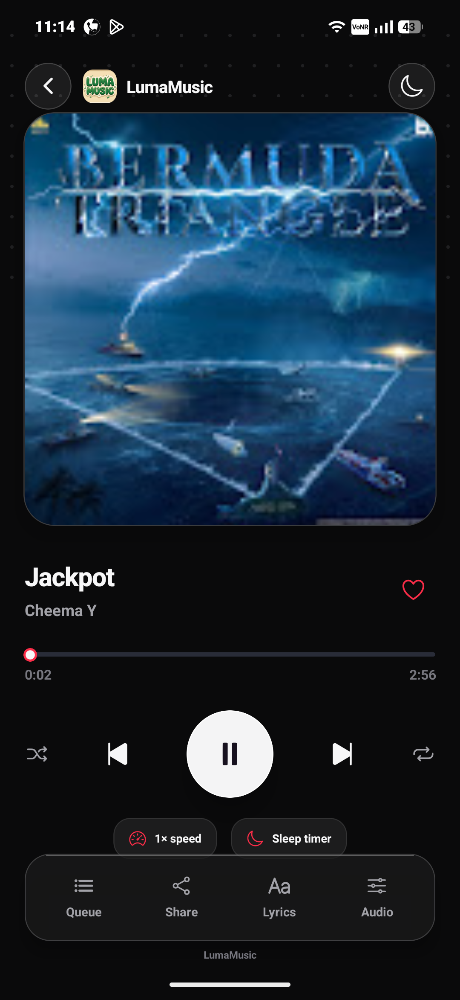

# LumaMusic

<div align="center">
  
  <h3>A dark, focused music player built with React Native and Expo.</h3>
  <p>Explore a music catalogue, play tracks, manage your listening library, and view listening activity.</p>
  <p>
    <a href="https://github.com/PauzeDevs/LumaMusic">Source code</a> ·
    <a href="https://lumamusic.devs.surf">Project website</a> ·
    <a href="LICENSE">EPL-2.0 License</a>
  </p>
  
  
</div>

> **Project status:** LumaMusic is under active development. Playback, catalogue availability, and device-specific behaviour may vary. Screenshots show the app interface and are not a guarantee that every feature or source is currently available on every device.

## Screenshots

<p align="center">
  
  
  
</p>

<p align="center">
  <sub>Home · Now Playing · Listening Stats</sub>
</p>

## What it does

LumaMusic is an open-source music-player project with a dark interface. The current codebase includes:

- **Discovery and search:** Browse the available catalogue and search for music.
- **Playback interface:** View the current track, artwork, playback progress, and transport controls.
- **Listening library:** Keep track of saved music and playlists supported by the app.
- **Listening statistics:** View recorded listening activity and top-track information when data is available.
- **Queue and lyrics surfaces:** Access the queue and lyrics areas from the player.
- **Audio controls:** The player exposes audio options. Actual effect support depends on the active playback path and device.
- **Background audio configuration:** The app is configured for background playback, but behaviour can vary by platform and playback source.

This is a work in progress. Do not assume that a control shown in the interface is fully supported in every build.

## Tech stack

- [React Native](https://reactnative.dev/) and [Expo](https://expo.dev/)
- [Expo Router](https://docs.expo.dev/router/introduction/) for navigation
- [Zustand](https://zustand.docs.pmnd.rs/) for state management
- [Expo Audio](https://docs.expo.dev/versions/latest/sdk/audio/) and [react-native-audio-api](https://github.com/software-mansion/react-native-audio-api) for audio-related functionality
- React Native WebView and native integrations where required

## Getting started

### Requirements

- Node.js compatible with the Expo SDK version declared in `package.json`
- npm
- Android Studio and an Android SDK for a local Android native build
- Xcode on macOS for an iOS native build

### Install dependencies

Clone the repository and install its dependencies:

```bash
git clone https://github.com/PauzeDevs/LumaMusic.git
cd LumaMusic
npm install
```

### Check the project

```bash
npx expo install --check
npm run typecheck
```

Or run both checks with:

```bash
npm run check
```

### Start the development server

```bash
npx expo start
```

Use the Expo development workflow to open the project on a supported device or emulator. Some native modules and configuration plugins require a development build; Expo Go may not include everything this project uses.

For a local native run, with the relevant platform toolchain installed:

```bash
npx expo run:android
```

```bash
npx expo run:ios
```

The iOS command requires macOS and Xcode. Before building for iOS, configure the Google Sign-In URL scheme with the correct iOS OAuth client value. The repository currently contains a placeholder value in `app.json`; Google Sign-In will not be correctly configured until it is replaced.

## How to use the app

1. **Explore music:** Open the home/discovery area and browse the recommendations and catalogue sections available in your build.
2. **Search:** Use the search tab to look for a track, artist, album, or other supported catalogue item.
3. **Open a result:** Select an item to view its available details or start playback.
4. **Use the player:** Open the Now Playing screen to pause or resume, move between tracks, adjust playback progress, and access the queue and other player surfaces.
5. **Save music:** Use the available library and playlist actions to organise items supported by the current build.
6. **Review activity:** Open Stats to see listening information recorded by the app. New or empty histories may show zero values until playback activity has been recorded.

Labels and available actions may change as the project develops.

## Audio sources, availability, and limitations

The current implementation has used unofficial YouTube / YouTube Music web endpoints and a NewPipe-based fallback for catalogue or playback resolution. These are undocumented integrations, not official APIs or an endorsement by the relevant providers. They can change, become unavailable, or behave differently across devices and regions.

- A catalogue result does not guarantee that its audio stream can be resolved or played.
- Playback may fail or stop if a source changes, blocks a request, or returns an unsupported stream.
- Equalizer and other audio-processing behaviour can depend on the playback path. Do not assume that every effect works with every streamed source.
- The app does not currently promise lossless audio, a particular bitrate, uninterrupted playback, or universal background playback.
- Track metadata and artwork may be supplied by third parties and may be incomplete or inaccurate.

Please report reproducible bugs with your device model, Android/iOS version, app build, and steps to reproduce. Do not include private tokens, account credentials, or other secrets in an issue.

## Privacy and permissions

The app's native configuration includes permissions and services related to media playback, including Android audio-settings access, foreground media playback, and notifications. Microphone recording is explicitly disabled in the Expo Audio configuration.

Permissions are used by the relevant operating-system integrations. Review the source code and platform permission prompts before installing or building the app. This README is not a complete privacy policy and does not make claims that no data is ever transmitted: network requests to configured music services and integrations are part of the app's functionality.

Never place OAuth client secrets, API keys, access tokens, or personal credentials in a public repository. Use appropriate local or build-time configuration for credentials.

## Legal and third-party notice

LumaMusic is an independent, unofficial software project. It is **not affiliated with, sponsored by, or endorsed by YouTube, YouTube Music, Google, or any artist, label, publisher, or other music-rights holder**. Product names and trademarks belong to their respective owners.

The current source includes integrations that communicate with YouTube / YouTube Music endpoints that are not documented as public developer APIs, as well as a NewPipe-based fallback. Provider terms, technical restrictions, copyright rules, and other laws may apply to how these integrations are accessed and used. Those rules can vary by jurisdiction and can change over time.

- LumaMusic does not grant users rights to music, recordings, compositions, artwork, videos, metadata, or other third-party material.
- Users are responsible for ensuring that their use of the app and any content they access complies with applicable law, copyright requirements, and the terms that apply to the relevant service.
- Do not use the app to download, copy, redistribute, publicly perform, or otherwise exploit content unless you have the necessary rights or permission.
- The presence of an endpoint or stream accessible over the internet does not mean that use of it is authorised.
- This project is not a substitute for an authorised music service or a licence from a rights holder.

**Important:** This notice is informational, not legal advice, and it cannot guarantee protection from claims, enforcement, account restrictions, or other legal consequences. Calling software “educational,” “personal,” or “non-commercial” does not by itself make every use lawful. Before distributing the app or enabling public use of its current stream-resolution integrations, obtain qualified legal advice and review the applicable provider terms and third-party licences. Consider replacing unofficial stream resolution with an authorised API, properly licensed catalogue, or user-directed playback flow.

## License

This repository is distributed under the **Eclipse Public License 2.0 (EPL-2.0)**. The authoritative terms are in [LICENSE](LICENSE). The EPL-2.0 applies to this project's covered code; it does not grant rights to third-party music or media accessed through the app.

Third-party dependencies and integrations remain subject to their own licences and terms. Review those notices before redistributing builds or modified versions.

---

<div align="center">
  Made by <a href="https://pauze.is-a.dev">PauzeDevs</a>
</div>
