<div align="center">
  
</div>

<div align="center">
  <h3>Less noise. More music.</h3>
  <a href="https://github.com/PauzeDevs/LumaMusic/actions/workflows/ci.yml"></a>
  <p>A music discovery experience built by <a href="https://github.com/PauzeDevs">PauzeDevs</a>.</p>
  <p><a href="https://LumaMusic.devs.surf">Visit the LumaMusic website ↗</a></p>
</div>

---

### THE EXPERIENCE

Search tracks, open the official YouTube Music page, and keep a personal library that feels like yours.

- **Discover** tracks through YouTube Music search.
- **Listen** by handing playback to the YouTube Music app or website.
- **Keep close** your favourites and recently opened tracks.
- **Organise** local playlists and your listening history.
- **Refresh** with LumaMusic's own animated pull-to-refresh treatment.

### UNDER THE HOOD

React Native · Expo · TypeScript · Expo Router · YouTube Music web search · TanStack Query · Zustand · AsyncStorage · expo-audio

### START THE APP

```bash
npm install
npx expo start
```

Use an Expo development build when testing native audio. The current YouTube Music integration is discovery plus external playback handoff. Native in-app YouTube Music streaming, background stream control and lock-screen synchronization are not implemented yet.

### PROJECT FILES

| Document | |
|---|---|
| Product direction | [Product specification](docs/PRODUCT_SPEC.md) |
| Architecture | [Technical architecture](docs/ARCHITECTURE.md) |
| Interface progress | [UI and integration status](docs/UI_PHASE.md) |
| API and playback | [Integration notes](docs/INTEGRATION_PHASE.md) |

### THE CATALOGUE

LumaMusic is an independent, unofficial project and is not affiliated with or endorsed by Google or YouTube. Discovery uses an undocumented public YouTube Music web interface that may change. Search results open their canonical YouTube Music pages. LumaMusic does not claim official Google authorization.

---

<div align="center">
  <sub>AN INDEPENDENT LISTENING SPACE / PAUZEDEVS</sub>
</div>
